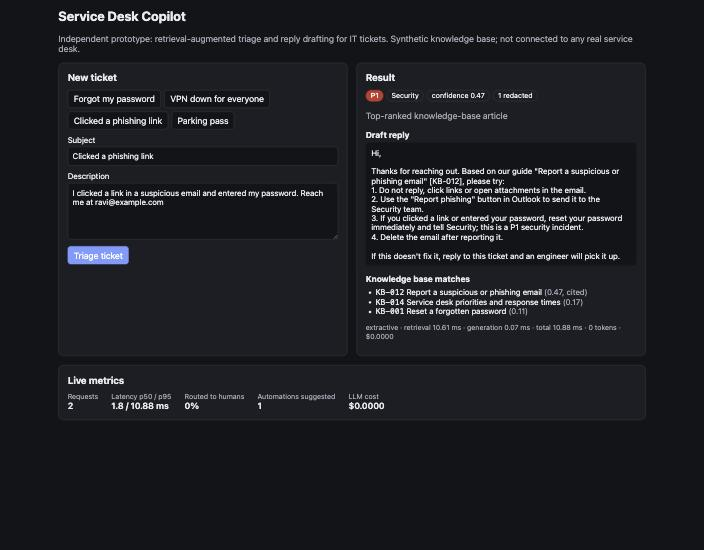

# Service Desk Copilot

[](https://github.com/chinthanshetty07/service-desk-copilot/actions/workflows/ci.yml)

A small, production-shaped AI service for IT support tickets: it retrieves the right knowledge-base
articles (RAG over a FAISS index), drafts a cited first reply, sets priority, flags tickets that can be
automated (like password resets), and **hands the ticket to a human when it isn't confident**. Every
request is measured: latency per stage, tokens and cost.

> **Independent concept.** I built this on my own after reading [Augustinnovate's](https://augustinnovate.com)
> AI Engineer posting and public service pages. It is not an Augustinnovate project, is not connected to
> Freshservice or any real service desk, and every ticket and article in it is synthetic.



## Why this prototype

What I could see publicly:

- Augustinnovate implements **Freshservice and Freshdesk**, and lists **"AI Automation"** among those services,
  with a headline of **"65% faster resolution"**.
- One of its case studies (Provana) reports **"95%+ password reset automation, reduced IT resolution time."**
- The AI Engineer role asks for **Python + FastAPI, LLMs in production, RAG, vector databases,
  Next.js/React, Docker, CI/CD**, and **AI monitoring and cost/latency optimisation**.

So I built the piece that sits between a ticket and an agent: retrieve, answer from the knowledge base
with citations, triage, suggest automation, and know when not to answer. I'm not claiming any client
has a particular problem; this is a demonstration of how I'd build that layer.

## What it does

```
ticket ─► redact PII ─► retrieve (FAISS, top-3 articles) ─► confident? ──no──► route to a human
                                                              │
                                                             yes
                                                              ▼
                        draft reply (extractive offline, or Claude with structured output)
                                                              │
                          validate citations ─► rule-based priority ─► suggest automation ─► record metrics
```

- **Retrieval:** articles are split into paragraphs, embedded, and stored in a FAISS inner-product index.
  The embedder is a one-class interface; it uses TF-IDF today so it runs with no downloads or keys.
- **Two drafting modes:**
  - `extractive` (default): builds the reply from the top article's resolution steps. Offline,
    deterministic, free.
  - `claude` (opt-in, `LLM_PROVIDER=claude`): `claude-opus-5-5` through the official `anthropic` SDK, with
    **structured outputs** (a JSON schema with a fixed category enum), `effort: low` for latency and cost,
    and server-side **refusal fallbacks**.
- **Guardrails:**
  - Emails and phone numbers are **redacted before any model call**, and ticket text is **never logged**.
  - Below a similarity threshold the service **abstains** and routes to a human instead of guessing.
  - Citations to articles that weren't retrieved are **dropped**; a reply with no valid citation is escalated.
  - Model refusals and unparseable output are escalated, never shown to the requester.
  - **Priority is rule-based** (P1 outage or security incident, P2 one user blocked, P3 the rest), so SLAs
    never depend on the model.
  - Automation is **suggested, never executed**, and only above a stricter confidence threshold; each
    action lists what it requires (for example identity verification).
- **Observability:** each request records retrieval, generation and total time, tokens, cost (from
  `response.usage` and list prices), provider, priority and abstention. `/metrics` reports p50/p95
  latency, abstain rate, automation suggestions and total cost; one JSON log line per request.

## Evaluation

`python -m eval.run_eval` runs 30 labelled synthetic tickets (27 answerable, 3 out of scope) and fails CI
if a gate is missed.

| Metric (extractive mode) | Result |
| --- | --- |
| Retrieval hit@1 / hit@3 | 100% / 100% |
| Category accuracy | 100% |
| Abstention correct (answer vs. hand to a human) | 100% |
| Priority accuracy | 96.7% (29/30) |
| Latency p50 / p95, warm | ~0.1 ms / ~0.2 ms |

**Read these honestly:** the set is small, and I wrote it alongside the knowledge base, so retrieval
scores are optimistic. The single miss ("forgot my password" labelled P2, rules say P3) is left in rather
than tuned away. The next step is a held-out set written by someone else, plus real paraphrases.

## Run it

```bash
# API (Docker, offline extractive mode)
docker compose up --build            # http://localhost:8000/health

# UI
cd frontend && npm install && npm run dev    # http://localhost:3000

# Tests and eval
cd backend && pip install -r requirements-dev.txt
pytest -q                            # 30 tests
python -m eval.run_eval              # metrics + quality gates

# Claude mode (uses your Anthropic credentials and costs money per request)
LLM_PROVIDER=claude docker compose up --build
```

API: `POST /triage {"subject", "description"}`, `GET /metrics`, `GET /kb`, `GET /health`. Interactive docs
at `http://localhost:8000/docs`.

## Tests and CI

30 pytest tests: knowledge-base parsing and validation; retrieval correctness and edge cases (unknown
words, empty queries); redaction and priority rules; the API (answer, abstain, P1 security, redaction,
metrics, validation); the **Claude drafter against a fake client** (request shape, structured output,
fallbacks, PII redacted in the prompt, dropped citations, refusals, bad JSON, cost maths); and the eval
quality gates. GitHub Actions runs the tests, the eval gates, a Docker build, and the Next.js build.

## Limitations and next steps

- **Claude mode is tested only against a mocked client.** I haven't run it against the live API, to avoid
  spending money on a demo. That's the first thing to do with a key.
- **TF-IDF retrieval** works on this small, clean knowledge base but won't handle paraphrase well at scale;
  swap in a neural embedder (the interface is ready) and a managed vector store (Chroma, Pinecone).
- **Rule-based priority** is predictable but brittle with unusual wording; it's a deliberate trade-off.
- **No Freshservice integration:** the next step is a webhook that receives new tickets and posts the draft
  as a private note for the agent to approve.
- **Metrics are in memory:** production would export them (OpenTelemetry or Prometheus) and add tracing
  per request.

Built by [Chinthan Shetty](https://chinthanshetty.in).
